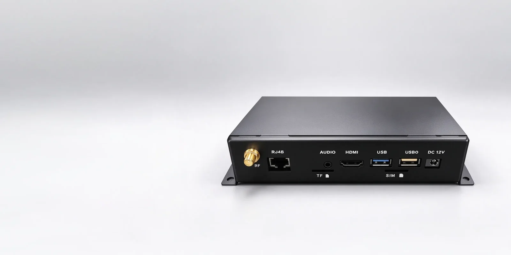
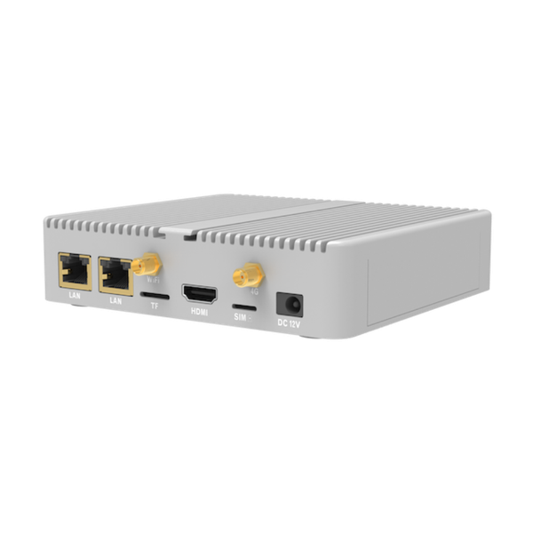
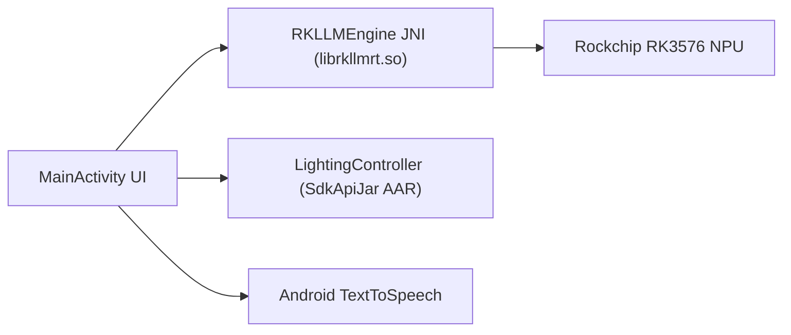

<div align="center">
  <a href="https://www.suntekai.com">
    <picture>
      <source media="(prefers-color-scheme: dark)" srcset="https://raw.githubusercontent.com/SUNTEK-Official/.github/main/profile/assets/logo-dark.png">
      <source media="(prefers-color-scheme: light)" srcset="https://raw.githubusercontent.com/SUNTEK-Official/.github/main/profile/assets/logo-light.png">
      
    </picture>
  </a>

  <h1>SUNTEK Edge AI On-Device LLM &amp; Voice Assistant Demo</h1>

  <p>
    <strong>Offline NPU LLM Inference &amp; Speech Interaction Reference</strong> &middot; <em>Enjoy Smarter Service</em><br>
    Reference Android application for <strong>SUNTEK AI-Box / RK3576</strong> edge compute terminals by <strong>SUNTEK Technology Co., Ltd.</strong>
  </p>

  <p>
    <a href="./LICENSE"></a>
    <a href="https://github.com/SUNTEK-Official/suntek-demo-edge-llm/releases"></a>
    
    <a href="https://www.suntekai.com/products/edge-ai-box-sa7/"></a>
  </p>

  
</div>

---

## Hardware Target & On-Device AI Capabilities

<table>
  <tr>
    <td align="center" width="38%">
      <a href="https://www.suntekai.com/products/edge-ai-box-sa7/">
        
      </a><br>
      <strong>SUNTEK AI-Box (SA7 / RK3576)</strong><br>
      <sub>Industrial Fanless Edge AI Computing Box</sub>
    </td>
    <td valign="top" width="62%">
      <ul>
        <li><strong>On-Device LLM</strong>: Offline Rockchip NPU inference (<code>librkllmrt.so</code> &amp; CMake <code>rkllm_jni</code>)</li>
        <li><strong>Hardware Lighting</strong>: Bundled <code>SdkApiJar_V1.250915.0914.aar</code> LED control via <code>LightingController</code></li>
        <li><strong>Application Package</strong>: <code>com.suntek.sample.edgeai</code> targeting Android SDK 36 (<code>arm64-v8a</code>)</li>
        <li><strong>Documentation</strong>: Detailed integration guide in <code>docs/voice-and-rkllm-guide.md</code></li>
      </ul>
    </td>
  </tr>
</table>



---

## Quick Setup

1. Prebuilt `arm64-v8a` native runtime libraries (`android/app/src/main/jniLibs/arm64-v8a/librkllmrt.so` &amp; `libomp.so`) and `android/app/libs/SdkApiJar_V1.250915.0914.aar` are bundled directly in the repository.
2. Download the quantized `.rkllm` model weights (`Qwen2.5-1.5B-Instruct_W8A8_RK3576.rkllm`) from [**GitHub Releases**](https://github.com/SUNTEK-Official/suntek-demo-edge-llm/releases) (or use the helper script for offline speech assets):
   ```bash
   bash ./scripts/setup_rkllm_model.sh
   python3 ./scripts/download_vosk_model.py --model vosk-model-small-en-us-0.15
   ```
3. Open `android/` in Android Studio (`arm64-v8a`, NDK CMake `3.22.1`) and build:
   ```bash
   cd android && ./gradlew assembleDebug
   ```

---

## Documentation & Support

- **Integration Guide**: [`docs/voice-and-rkllm-guide.md`](./docs/voice-and-rkllm-guide.md)
- **Changelog**: [`CHANGELOG.md`](./CHANGELOG.md)
- **Technical Support**: [support@suntekai.com](mailto:support@suntekai.com) &middot; [Open an Issue](https://github.com/SUNTEK-Official/.github/issues/new/choose)

---

<div align="center">
  
  <br><br>
  <strong>SUNTEK Technology Co., Ltd.</strong> &mdash; <em>Smart Commercial Terminal Hardware Manufacturer Since 2010</em><br>
  <sub>80+ Export Countries &middot; 5,000,000+ Terminals Shipped &middot; ISO 9001 / ISO 27001 / CE / RoHS</sub><br>
  <sub><a href="https://www.suntekai.com">www.suntekai.com</a> &middot; Copyright &copy; 2026 SUNTEK Technology Co., Ltd. All rights reserved.</sub>
</div>
